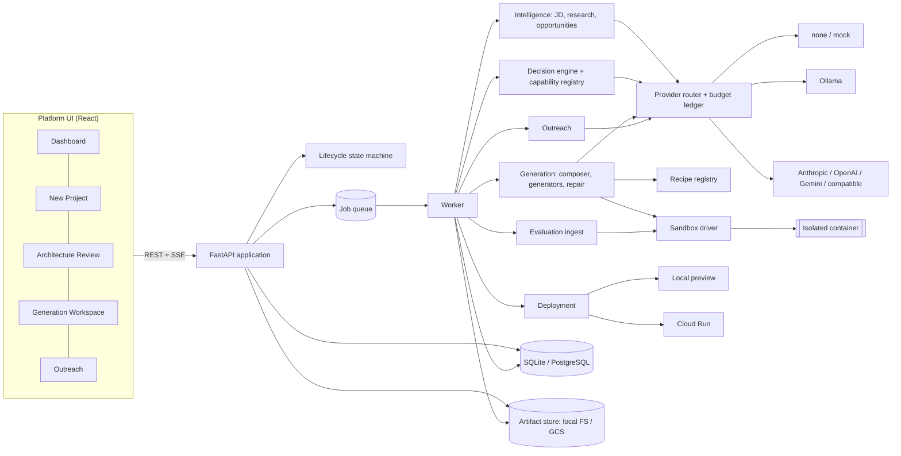
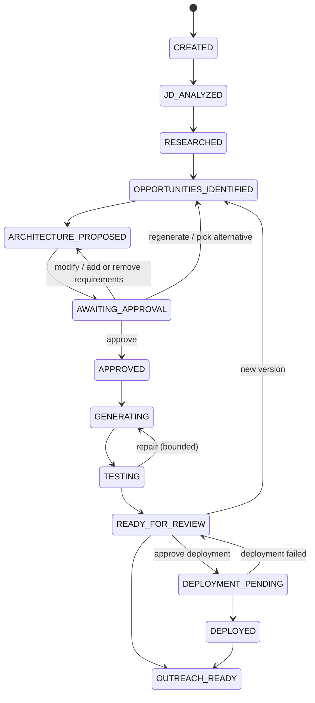

# ProtoPitch — Architecture

Status: **proposed, awaiting owner approval.** No application code exists yet.
Source specification: `ProtoPitch_Complete_Master_Prompt.pdf` (cited as §N).
Rationale for departures from the specification: `docs/SPEC_REVIEW.md`.

---

## 1. What ProtoPitch is

A single-user, local-first web application that turns a job description into a tested,
company-relevant working prototype and a hiring-manager outreach draft:

```
JD → analysis → company research → opportunities → architecture proposal
   → owner approval → generation → test/repair → evaluation → review
   → (optional) deployment → (optional) outreach drafts
```

It is a factory: each JD becomes an independent, versioned project. The owner approves what
is built but does not choose algorithms or frameworks.

## 2. Principles that constrain every design choice

1. **Deterministic first.** Every pipeline stage has an implementation that needs no model,
   no key and no download. Models improve results; they are never required.
2. **Evidence or label.** Every statement about a company or the candidate is a `Claim` with
   a kind (`VERIFIED`, `USER_PROVIDED`, `INFERRED`, `HYPOTHESIS`) and source references.
3. **Measured or absent.** Metrics reach reports only from result files written by sandboxed
   evaluation runs.
4. **Generators write, the sandbox executes.** Nothing generated runs outside the sandbox.
5. **Approval before side effects.** Building, paid calls, corpus use, repository creation,
   deployment and deletion each require a recorded approval of the exact payload.
6. **Extension by registration.** New capabilities, recipes, providers, sandbox drivers and
   deployment targets are added as plugins or data; the core does not change.
7. **No model identity in code.** Provider and model names exist only in configuration.

## 3. System overview



One backend process serves the API; one worker process runs jobs. Both are the same Python
package. There are no microservices.

## 4. Technology stack

| Layer | Choice | Notes |
|-------|--------|-------|
| Platform frontend | React, TypeScript, Vite, Tailwind | As §17. |
| Demo frontend | Prebuilt **demo shell** (React) driven by a manifest | Built once with the platform; copied into each generated project. |
| Backend | Python 3.12, FastAPI, Pydantic v2 | 3.12 for wheel availability across ML libraries. |
| Persistence | SQLAlchemy 2 + Alembic; SQLite (WAL) locally, PostgreSQL optional | No raw SQL in feature code. |
| Artifacts | `ArtifactStore` interface: local filesystem, Google Cloud Storage | Content-hashed. |
| Jobs | DB-backed queue, single worker, leased checkpointed steps | No Redis, no Celery. |
| Orchestration | Plain state machine | LangGraph is not used in the platform core. |
| Deterministic intelligence | YAML taxonomies, scikit-learn (TF-IDF), rank-bm25 | |
| Generated prototypes | FastAPI, NumPy, Pandas, scikit-learn, SciPy, rank-bm25, FAISS; LangGraph / LangChain / PyTorch only when the decision engine justifies them | |
| Sandbox | Docker containers (default driver) | Interface allows other drivers. |
| Tooling | uv, Ruff, mypy, pytest, Vitest, Playwright | |
| CI | GitHub Actions (free tier) | |
| Deployment | Docker; local preview; Cloud Run + Cloud Storage optional | Target interface keeps AWS App Runner possible. |

## 5. Project lifecycle

State names are those of §3. Transitions are explicit; anything not listed is rejected.



Rules not shown in the diagram:

- Any working state may go to `FAILED`. `FAILED` stores `failed_from`, the failing step and
  diagnostics; **resume** returns to the last completed checkpoint.
- Any state may go to `ARCHIVED`; unarchive restores the previous state.
- "Save for later" leaves the project in `AWAITING_APPROVAL`.
- Starting a new version from `READY_FOR_REVIEW` or later creates `ProjectVersion n+1`; the
  earlier version's proposal, code, evaluation and deployment are kept untouched.
- A project is never `READY_FOR_REVIEW` unless every check marked critical passed.

### Jobs and recovery

Each pipeline stage is a **job** made of **steps**. A step declares its inputs, writes its
outputs as artifacts, and is idempotent for a given input hash. The worker holds a lease with
a heartbeat on the running step. After a crash, expired leases are detected at start-up and
the job continues from the first incomplete step. Step logs stream to the UI over
server-sent events and are stored.

## 6. Data model

All entities carry `id` (UUID), timestamps and, where relevant, `project_id` and `version`.

| Entity | Purpose | Key fields |
|--------|---------|-----------|
| `Project` | One JD engagement | company, role, status, active_version, failed_from |
| `ProjectVersion` | One iteration of a project | number, parent, reason, status snapshot |
| `JDDocument` | Original JD, immutable | raw text, URL, language, content hash |
| `JDAnalysis` | Structured reading of the JD | role, seniority, location, domain, responsibilities, skills (required / preferred), capabilities, objectives; each item has `evidence: EXPLICIT or INFERRED`, confidence, text span, analyser id |
| `Source` | A retrieved or supplied document | type, URL, retrieved_at, hash, permission basis, licence |
| `Claim` | A statement backed by sources | text, kind, source ids, confidence, produced_by |
| `ResearchReport` | Company context | claim ids, limitations, coverage |
| `CandidateProfile`, `ProfileItem` | Editable candidate record | item type (skill, experience), text, **evidence level**: `VERIFIED_PRODUCTION`, `VERIFIED_POC`, `KNOWLEDGE`, `DEMONSTRATED_IN_PROTOPITCH`, `UNVERIFIED` |
| `FitAssessment` | Candidate vs JD | per-requirement match with profile item and level |
| `Opportunity` | Candidate prototype idea | problem statement, archetype, claim ids, `ProblemSpec`, 12 criterion scores, total, selected flag |
| `ArchitectureProposal` | What will be built | version, opportunity, recipe plan, components, technology decisions (selected and excluded, with reasons), data plan, evaluation plan, diagram source, limitations, effort and cost estimate, JD coverage map |
| `Approval` | Recorded authorisation | kind, payload hash, decision, comment, time |
| `BuildRun` | One generation attempt | proposal, generation mode, status, budgets, workspace ref |
| `Job`, `Step` | Execution records | type, status, lease, attempt, input hash, log ref |
| `RepairAttempt` | One diagnose-and-fix cycle | failure class, fixer, diff ref, outcome |
| `CheckReport` | Result of a validation check | check type, critical flag, pass or fail, output ref |
| `EvaluationReport`, `Metric` | Measured results | metric name, value, **kind**: `MEASURED`, `SYNTHETIC_EXPERIMENT`, `SIMULATED`, `ESTIMATE`, `NOT_EVALUATED`; run id, seed, data hash |
| `Artifact` | Stored file or bundle | kind, path, hash, size |
| `Deployment` | A deployed demo | target, URL, resources, estimate, expiry, status |
| `Contact` | User-entered person | name, role, channel; entered_by_user always true |
| `OutreachDraft` | LinkedIn or email draft | channel, text, links, claim-check result, status |
| `ProviderCall` | Ledger entry | task, provider, model, tokens, estimated and actual cost, outcome |
| `AuditEvent` | Append-only history | actor, action, subject, details |

The candidate profile is stored in the database, edited in the UI, and importable or
exportable as YAML. It never requires a code change (§2).

## 7. Modules and interfaces

Package root: `backend/protopitch/`. Interfaces below are contracts, shown as signatures.

### 7.1 JD intelligence — `intelligence/jd`

```python
class JDAnalyzer(Protocol):
    id: str
    def analyze(self, jd: JDDocument, hints: JDHints) -> JDAnalysis: ...
```

- `DeterministicJDAnalyzer`: section segmentation → term matching against the skill taxonomy
  (synonyms, weights) → capability inference through the **implication graph** (for example
  "recommendation" implies candidate generation, ranking, offline ranking evaluation; "RAG"
  implies retrieval, grounding, retrieval evaluation) → seniority, location and
  engineering-expectation heuristics. Items found in the text are `EXPLICIT`; items reached
  through the graph are `INFERRED` and carry the rule that produced them.
- `ModelJDAnalyzer`: optional refinement through the provider router. Its output is merged
  into, not substituted for, the deterministic result; disagreements are kept visible.
- `JDHints` carries the company, role and URL typed by the user; these override extraction.

### 7.2 Company research — `intelligence/research`

```python
class SourceCollector(Protocol):
    def collect(self, request: ResearchRequest) -> list[Source]: ...
class EvidenceExtractor(Protocol):
    def extract(self, sources: list[Source], focus: JDAnalysis) -> list[Claim]: ...
```

Collectors: user documents, user URLs, official-site crawler (home page, sitemap, product,
documentation, blog, careers; depth and page limits; `robots.txt` honoured), cache. All
fetching passes through `security.UrlGuard`. An optional search collector exists only as an
interface; no search API is required. Extraction is extractive by default: passages relevant
to the JD's capabilities become `VERIFIED` claims quoting their source. Anything produced
without a source is stored as `HYPOTHESIS`. If nothing can be collected, the report says so
and the pipeline continues.

### 7.3 Opportunities — `intelligence/opportunities`

```python
class OpportunityGenerator(Protocol):
    def propose(self, jd: JDAnalysis, research: ResearchReport, fit: FitAssessment) -> list[Opportunity]: ...
class OpportunityScorer:
    def score(self, opp: Opportunity, ctx: ScoringContext) -> ScoreCard: ...
```

The deterministic generator instantiates **archetypes** (data files: personalised ranking,
grounded documentation assistant, tool-using support agent, demand forecast, propensity
model, pipeline monitoring, natural-language-to-SQL …) with domain entities found in research
claims. A model-backed generator may add ideas; they pass through the same scorer and any
company statement without a source is downgraded to `HYPOTHESIS`.

Scoring criteria (§6), each 0–1 with a configurable weight and a recorded reason: JD
relevance, company relevance, skills coverage, business value, credibility, feasibility
(recipe exists), data availability, evaluability, demo impact, cost, candidate alignment,
generation time. The top result is selected; the rest are stored for regeneration and
comparison.

### 7.4 Capability registry — `decision/registry`

Data, not code (`taxonomy/capabilities.yaml`, `taxonomy/skills.yaml`,
`taxonomy/technologies.yaml`):

```yaml
- id: retrieval.hybrid
  parent: retrieval
  signals: [{term: "hybrid search", weight: 1.0}, {term: "bm25", weight: 0.6}]
  implies: [retrieval.keyword, retrieval.vector, evaluation.retrieval]
  metric_families: [retrieval]
```

Initial top-level capabilities: classification, regression, forecasting, recommendation,
ranking, personalisation, deep learning, NLP, computer vision, RAG, hybrid retrieval, modular
RAG, agentic AI, tool calling, multi-agent systems, MLOps, LLMOps, evaluation, data
engineering, monitoring. Recipes declare which capabilities they `provide`. A capability
with no providing recipe is *recognised but not buildable in G1* — a fact the proposal
states.

### 7.5 Architecture decision engine — `decision/engine`

Input: selected `Opportunity` with its `ProblemSpec`. Output: `ArchitectureProposal`.

`ProblemSpec` is a structured description, not free text: problem type, required
capabilities, data modality and volume, interaction pattern (`stateful`, `has_cycles`,
`tool_count`, `needs_planning`, `human_in_loop`), sequence structure, cold-start relevance,
latency and resource constraints, metric families.

Steps:

1. **Candidate architectures** — recipe compositions whose `provides` cover the required
   capabilities and whose `applicable_when` predicates hold.
2. **Technology decisions** — each entry in `technologies.yaml` has `justified_when`
   predicates over `ProblemSpec`. Examples:

   | Technology | Justified when |
   |------------|----------------|
   | LangGraph | workflow is stateful **and** has cycles, branching or resumable steps |
   | LangChain | at least one integration (loader, retriever, tool) saves real code |
   | Google ADK | agent capabilities needed **and** Google ecosystem is part of the problem |
   | Simple RAG | single-hop grounded question answering |
   | Modular / agentic RAG | multi-hop, query routing or tool use measurably needed |
   | Classical ML | tabular data, limited volume |
   | Deep learning | unstructured data or volume where it outperforms baselines |
   | LSTM | sequence problem with order-dependent signal and enough history |
   | Plain deterministic pipeline | none of the agent predicates hold |

   A technology the JD lists is tagged `employer_listed`; that tag affects coverage
   reporting only. Every technology ends up `SELECTED` or `EXCLUDED` with a reason.
3. **Trade-off comparison** — candidates ranked on fit, complexity, resource need and
   evaluability; the winner and rejected alternatives are recorded.
4. **Plans** — data plan (synthetic generator or approved dataset, with provenance),
   evaluation plan (metrics from the capability's metric families), resource and cost
   estimate, JD coverage map (covered / not covered), limitations.
5. **Diagram** — Mermaid source generated from the component graph.

A model may add narrative explanation; it cannot change the selected components.

### 7.6 Approval checkpoint — `api/approvals`

The review screen renders the proposal in plain language with technical detail on demand and
offers: approve and build, request modifications, add or remove requirements, regenerate,
compare alternatives, save for later (§8). Modifications are structured edits to the
`ProblemSpec` or constraints; the engine re-runs and issues a new proposal version. An
`Approval` binds to the proposal's hash — editing the proposal invalidates it.

### 7.7 Recipes — `recipes/`

A recipe is a directory with a manifest, templates and a small Python class, discovered
through the `protopitch.recipes` entry-point group or a user recipes directory.

```yaml
id: recsys.implicit_feedback
version: 1.0.0
kind: solution            # solution or component
provides: [recommendation, ranking, personalisation, evaluation.ranking]
applicable_when: { problem_type: [recommendation], data_modality: [interactions] }
prerequisites: { sandbox_profile: ml-core }
required_data: { interactions: [user, item, timestamp], item_features: optional }
parameters: { ... JSON Schema ... }
components: [data.synthetic.interactions, algo.popularity, algo.item_knn, algo.content_tfidf, algo.mf_als, rank.gbdt, eval.ranking, serve.fastapi, ui.panels.recommend]
dependencies: { profile: ml-core, extra: [] }
evaluation: { metrics: [precision@k, recall@k, ndcg@k, coverage, diversity, cold_start] }
tests: [unit, api, smoke_train, eval_runs]
resources: { cpu: 2, memory_gb: 2, est_minutes: 5 }
failure_conditions: [insufficient_interactions, memory_exceeded]
extension_points: [feature_builder, reranker, ui_panel]
```

```python
class Recipe(Protocol):
    manifest: RecipeManifest
    def plan(self, spec: ProblemSpec, params: dict) -> RecipePlan: ...
    def render(self, plan: RecipePlan, workspace: Workspace) -> list[GeneratedFile]: ...
    def demo_manifest(self, plan: RecipePlan) -> DemoManifest: ...
    def checks(self, plan: RecipePlan) -> list[CheckSpec]: ...
```

Every recipe must pass the **recipe conformance suite** (renders, installs within its
profile, tests pass in the sandbox, evaluation writes a valid results file).

v1 catalogue:

| Recipe | Scenario | Content |
|--------|----------|---------|
| `recsys.implicit_feedback` | A | popularity baseline, item-kNN, content-based, matrix factorisation, ranking stage, optional two-tower model (PyTorch profile) |
| `rag.grounded_qa` | B | ingestion, chunking, BM25, dense index, hybrid fusion, optional reranking, cited answers (extractive, or generative when a model is configured) |
| `agent.tool_workflow` | B | LangGraph state graph, tool registry, traces, scripted evaluation scenarios; composes with `rag.grounded_qa` |
| `mlops.pipeline_monitoring` | C | data validation, training pipeline, file-based model registry, drift detection, monitoring view, CI workflow |

Planned next: `forecasting.timeseries`, `tabular.propensity`, `nl2sql.assistant`.

### 7.8 Generation — `generation/`

```python
class Generator(Protocol):
    mode: Literal["G1", "G2", "G3"]
    def generate(self, proposal: ArchitectureProposal, workspace: Workspace, budget: Budget) -> GenerationResult: ...
```

- **G1 `RecipeComposer`** — resolves the recipe plan, renders files, writes the demo manifest,
  documentation and provenance.
- **G2 `SlotFiller`** — after G1, asks a model for code for declared extension points only.
  Each slot has a typed interface and tests; a failing slot reverts to the default and the
  reversion is recorded.
- **G3 `AgentGenerator`** — hands the approved architecture and an empty project skeleton to
  a coding model or authorised coding agent with file-edit access to the workspace only.

Generated project layout (its own Git repository, in `data/workspaces/<project>/<version>/`):

```
app/        FastAPI service (health, demo endpoints)
core/       algorithms and pipelines
data/       generators, datasets, provenance.json
eval/       evaluation entry point → results.json
tests/
web/        demo shell bundle + demo.manifest.json
docs/       ARCHITECTURE.md, EVALUATION.md, WALKTHROUGH.md
Dockerfile  README.md  LICENSE  protopitch.lock.json
```

`protopitch.lock.json` records recipes and versions, parameters, seeds, generation mode and
any model involvement, so a build is reproducible.

### 7.9 Validation and repair — `generation/repair`, `evaluation/`

Checks run in the sandbox in a fixed order; each is flagged critical or advisory:
dependency resolution, lint and type check, unit tests, API tests, training and inference
smoke test, data validation, evaluation run, container build, start-up and health check,
secret and security scan.

On failure: classify (dependency, syntax, import, test assertion, timeout, memory, data) →
apply a deterministic fixer if one matches → otherwise, if a debugging model is configured
and budget remains, request a patch → re-run the failing check and everything after it.
Limits: 3 repair attempts per build, per-step and per-build time caps, token and spend caps.
Every attempt is stored. When limits are hit the build is `FAILED`, partial work is kept and
the diagnostics name the failing check and suggested next actions.

Evaluation results enter the platform only as `eval/results.json` written inside the
sandbox, validated against a schema, with run id, seed and data hash. Reports and outreach
render numbers from these records. A lint rejects any generated document containing a
number that is not in the results.

### 7.10 Sandbox — `sandbox/`

```python
class SandboxDriver(Protocol):
    def run(self, spec: SandboxSpec) -> SandboxResult: ...
    def serve(self, spec: SandboxSpec, port: int) -> ServeHandle: ...
```

`DockerSandboxDriver` defaults:

| Control | Setting |
|---------|---------|
| User | non-root, fixed UID |
| Filesystem | read-only root, tmpfs `/tmp`, only this build's workspace mounted |
| Network | none for build, test and evaluation; internal no-egress network for local preview, port published on `127.0.0.1` only |
| Privileges | all capabilities dropped, `no-new-privileges`, no Docker socket |
| Resources | CPU, memory and process limits from the recipe; wall-clock kill |
| Environment | empty; no host variables passed |
| Images | prebuilt profiles with pinned dependencies: `core` (Python, NumPy, Pandas, scikit-learn, SciPy, FastAPI, pytest, rank-bm25, FAISS, LangGraph), `torch` (adds CPU PyTorch; opt-in) |
| Extra dependencies | allowlist, hash-pinned, wheels only, installed in a separate resolver container that has index access but no workspace code and no secrets |

`SubprocessSandboxDriver` exists for platform unit tests only and refuses to run generated
code unless an explicit unsafe flag is set.

### 7.11 Providers — `providers/`

```python
class LLMProvider(Protocol):
    name: str
    def capabilities(self) -> ProviderCapabilities: ...
    def estimate(self, request: LLMRequest) -> CostEstimate: ...
    def complete(self, request: LLMRequest) -> LLMResponse: ...   # supports schema-constrained output

class CodingAgentProvider(Protocol):
    def run(self, task: AgentTask, workspace: Workspace, budget: Budget) -> AgentResult: ...
```

Adapters: `none` (default), `mock`, `ollama`, `anthropic`, `openai`, `gemini`,
`openai_compatible`, and coding-agent adapters. Routing is configuration:

```yaml
# config/providers.yaml — model names appear here and nowhere else
tasks:
  jd_analysis:            { use: deterministic }
  research_synthesis:     { use: deterministic }
  opportunity_generation: { use: deterministic }
  architecture_reasoning: { use: deterministic }
  code_generation:        { use: none }
  debugging:              { use: none }
  evaluation_judge:       { use: none }
  documentation:          { use: deterministic }
  outreach:               { use: deterministic }
# example opt-in:  outreach: { use: ollama, model: "<local model>", on_failure: deterministic }
budgets: { per_call_usd: 0, per_project_usd: 0, per_month_usd: 0 }
```

Rules enforced by the router:

- Start-up needs no key and performs no download. Missing keys disable an adapter; they do
  not fail the application.
- A paid adapter is used only if configured for that task, within budget, and covered by an
  approval for the project.
- No automatic switch to a different paid provider. `on_failure` may be `fail` (default) or
  `deterministic`; a deterministic fallback is recorded on the artifact and shown.
- Every call is written to the `ProviderCall` ledger with estimated and actual cost. Model
  spend is reported separately from hosting spend.
- A consumer chat subscription is not an API credential; the coding-agent adapters document
  what each tool's terms allow and require the owner to enable them.

### 7.12 Deployment — `deploy/`

```python
class DeploymentTarget(Protocol):
    def plan(self, build: BuildRun) -> DeploymentPlan: ...       # resources, estimate, security notes
    def apply(self, plan: DeploymentPlan, approval: Approval) -> Deployment: ...
    def rollback(self, deployment: Deployment) -> None: ...
    def teardown(self, deployment: Deployment, approval: Approval) -> None: ...
```

Targets: `local` (sandbox preview), `cloud_run_shared` (one demo-host service serving
standard-profile G1/G2 demos from Cloud Storage, zero-permission service account, separate
cloud project, no secrets), `cloud_run_dedicated` (own service when dependencies, compute,
security or scaling require it). Deployed services: health endpoint, structured logs,
scale to zero, instance cap, no reliance on the local filesystem. The plan screen shows
resources, estimated cost and security posture; nothing is provisioned before approval.

### 7.13 Outreach — `outreach/`

Produces a LinkedIn note, a longer LinkedIn message and an email per project, plus a
prototype summary and links. Drafts are templates filled from the proposal, evaluation
records and profile; a model may rephrase. A **claim check** blocks a draft that:

- cites experience below the required evidence level, or describes the prototype as past
  employment;
- contains a metric not in the evaluation records, or omits its kind (synthetic data);
- asserts knowledge of internal company matters, or a relationship that does not exist;
- lacks the independence and synthetic-data disclosure.

The engine suggests target role titles. People are only ever user-entered `Contact` records
or names quoted from a stored source. There is no send function.

### 7.14 Source control — `scm/`

Each generated project is a local Git repository with a commit per build and per repair.
The optional GitHub adapter creates a repository and pushes only after an approval that
names the repository and visibility, and after the secret scan passes.

### 7.15 Security services — `security/`

`UrlGuard` (request filtering), `Sanitizer` (HTML and Markdown), `Redactor` (logs),
`SecretScanner` (workspaces and outbound content), `PromptEnvelope` (wraps untrusted text as
data, strips control sequences, enforces length), `ApprovalGate` (decorator that refuses
side-effecting calls without a matching approval).

## 8. End-to-end workflows

### 8.1 New project to approval

1. Owner submits JD text, company, role, optional URL and documents → `CREATED`.
2. `analyze_jd` job → `JDAnalysis`, `FitAssessment` → `JD_ANALYZED`.
3. `research` job → `Source`s, `Claim`s, `ResearchReport` (possibly empty, with limitations)
   → `RESEARCHED`.
4. `identify_opportunities` job → scored `Opportunity` list, one selected →
   `OPPORTUNITIES_IDENTIFIED`.
5. `propose_architecture` job → `ArchitectureProposal` v1 → `ARCHITECTURE_PROPOSED` →
   `AWAITING_APPROVAL`.
6. Owner approves, modifies (back to step 5), or regenerates (back to step 4).

Steps 2–5 run without owner input and without any model by default.

### 8.2 Build

1. `APPROVED` → `BuildRun` created with mode and budgets → `GENERATING`.
2. Generator writes the workspace; initial commit.
3. `TESTING`: checks run in the sandbox; repair loop within limits.
4. Evaluation results ingested; documents rendered from records.
5. All critical checks pass → `READY_FOR_REVIEW`; otherwise `FAILED` with diagnostics.
6. Owner reviews the live local demo, code, architecture, evaluation and documentation.

### 8.3 Deployment and outreach (both optional, independent)

- Deployment: plan → owner approval → apply → health validation → `DEPLOYED`, or rollback
  and return to `READY_FOR_REVIEW`.
- Outreach: owner picks target role and optionally enters a contact → drafts → claim check →
  `OUTREACH_READY`. The owner copies and sends the message personally and may record that
  it was sent.

## 9. Demo experience

The demo shell renders a `demo.manifest.json`:

```json
{ "title": "...", "problem": "...", "disclosures": ["Synthetic data", "Independent demonstration"],
  "panels": [ { "type": "interactive", "endpoint": "/recommend", "inputs": [...], "output": "ranked_list" },
              { "type": "metrics", "source": "/evaluation" },
              { "type": "architecture", "diagram": "..." },
              { "type": "trace", "endpoint": "/trace" } ] }
```

Panel types cover forms, ranked lists, cited answers, step traces, metric tables, charts,
architecture diagrams and limitations. The first screen states the problem, why it is
relevant to the role, and offers one working interaction; evaluation and architecture are
one click away. Disclosures are always visible.

## 10. Repository layout (to be created in M1)

```
backend/protopitch/{api,domain,db,jobs,intelligence,decision,recipes,generation,
                    sandbox,evaluation,providers,deploy,outreach,scm,security,storage}
backend/tests/
frontend/            platform UI
demo-shell/          manifest-driven demo UI
taxonomy/            skills, capabilities, technologies, archetypes (YAML)
config/              providers.yaml, scoring.yaml, limits.yaml, prices.yaml
sandbox-images/      Dockerfiles for sandbox profiles
docs/                specification review and guides
data/                runtime: database, artifacts, workspaces (git-ignored)
```

## 11. Decision log

| ID | Decision | Reason |
|----|----------|--------|
| A1 | Single-user, localhost-only platform in v1 | No auth requirement in spec; platform holds keys and runs generated code |
| A2 | Plain state machine and DB job queue; no agent framework in the core | Recoverability, testability, fewer dependencies |
| A3 | Three generation modes with stated limits | Reconciles autonomy with zero-API operation |
| A4 | Manifest-driven demo shell instead of per-project frontend builds | Speed, reliability, no network in sandbox |
| A5 | Docker sandbox with prebuilt dependency profiles | Isolation and dependency control without network at build time |
| A6 | Generators never execute; sandbox never holds credentials | Separates untrusted execution from secrets |
| A7 | Capability registry and technology rules as data | Extension without core changes |
| A8 | JD-listed technology never self-justifies | Spec §7, §27 |
| A9 | Claims and metrics are typed records; documents render from them | Integrity rules become enforceable checks |
| A10 | Routing and model names only in configuration; default routing is deterministic or none | Model independence, zero-cost default |
| A11 | Deployment and outreach are optional facets | Local-first; outreach possible with repository link only |
| A12 | Shared demo host restricted to G1/G2 standard-profile demos | Cost aim of §19 with bounded isolation risk |
| A13 | Draft-only outreach, user-entered contacts | Spec §16 constraints |
| A14 | Reference prototypes built first, recipes extracted from them | Avoids premature abstraction |
