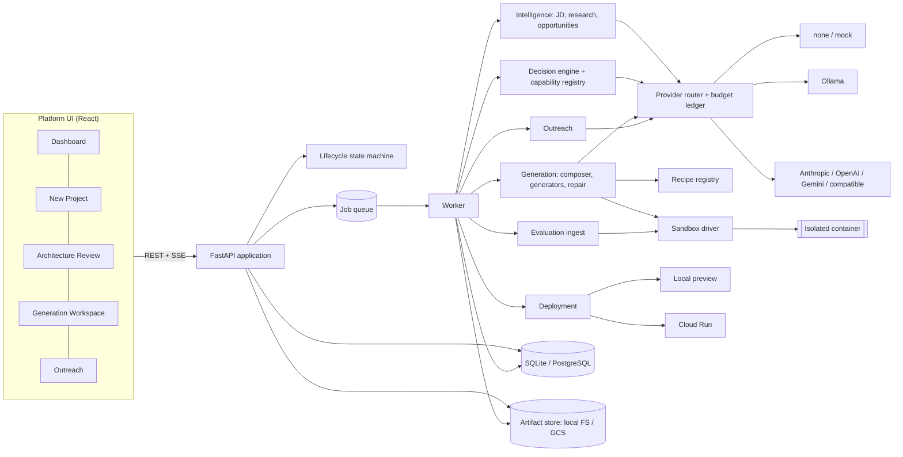
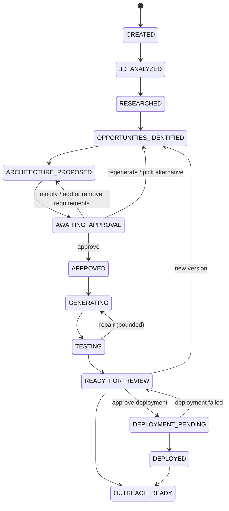

# ProtoPitch — Architecture

Status: **approved by the owner (revision 2.1).** Revision 2 was approved on 2026-11-16
subject to three clarifications, incorporated as decisions A25–A27 (§11): restricted
egress by default for dedicated cloud services (§7.12, §12), platform-owned evaluation
(§7.9), and a real coding-agent acceptance test (§7.8). Implementation has not started and
needs separate authorisation (see `IMPLEMENTATION_PLAN.md`).
Source specification: `ProtoPitch_Complete_Master_Prompt.pdf` (cited as §N).
Rationale for departures from the specification: `docs/SPEC_REVIEW.md`.

---

## 1. What ProtoPitch is

A single-user, local-first web application that turns a job description into a tested,
company-relevant working prototype and a hiring-manager outreach draft:

```
JD → analysis → company research → opportunities → architecture proposal
   → owner approval → generation → test/repair → evaluation → review
   → (optional) deployment → (optional) outreach drafts
```

It is a factory: each JD becomes an independent, versioned project. The owner approves what
is built but does not choose algorithms or frameworks.

## 2. Principles that constrain every design choice

1. **Deterministic first.** Every pipeline stage has an implementation that needs no model,
   no key and no download. Models improve results; they are never required.
2. **Evidence or label.** Every statement about a company or the candidate is a `Claim` with
   a kind (`VERIFIED`, `USER_PROVIDED`, `INFERRED`, `HYPOTHESIS`) and source references.
3. **Claims trace to records.** Performance claims must match evaluation records written by
   sandboxed runs; business-impact statements must be labelled estimates with assumptions.
   Ordinary technical numbers (versions, dates, configuration) are unrestricted.
4. **Generated code runs only inside an isolation boundary** — the local sandbox, an agent
   container, or a dedicated cloud service — never in the platform process and never beside
   platform credentials (§12).
5. **Approval before side effects.** Building, paid calls, corpus use, repository creation,
   deployment and deletion each require a recorded approval of the exact payload.
6. **Extension by registration.** New capabilities, recipes, providers, sandbox drivers and
   deployment targets are added as plugins or data; the core does not change.
7. **No model identity in code.** Provider and model names exist only in configuration.

## 3. System overview



One backend process serves the API; one worker process runs jobs. Both are the same Python
package. There are no microservices.

## 4. Technology stack

| Layer | Choice | Notes |
|-------|--------|-------|
| Platform frontend | React, TypeScript, Vite, Tailwind | As §17. |
| Demo frontend | G1/G2: prebuilt **demo shell** (React) driven by a manifest. G3: custom frontend when the problem needs one | Shell is built once with the platform; custom frontends build in the `web` sandbox profile. |
| Backend | Python 3.12, FastAPI, Pydantic v2 | 3.12 for wheel availability across ML libraries. |
| Persistence | SQLAlchemy 2 + Alembic; SQLite (WAL) locally, PostgreSQL optional | No raw SQL in feature code. |
| Artifacts | `ArtifactStore` interface: local filesystem, Google Cloud Storage | Content-hashed. |
| Jobs | DB-backed queue, single worker, leased checkpointed steps | No Redis, no Celery. |
| Orchestration | Plain state machine | LangGraph is not used in the platform core. |
| Deterministic intelligence | YAML taxonomies, scikit-learn (TF-IDF), rank-bm25 | |
| Generated prototypes | FastAPI, NumPy, Pandas, scikit-learn, SciPy, rank-bm25, FAISS; LangGraph / LangChain / PyTorch only when the decision engine justifies them | |
| Sandbox | Docker containers (default driver) | Interface allows other drivers. |
| Tooling | uv, Ruff, mypy, pytest, Vitest, Playwright | |
| CI | GitHub Actions (free tier) | |
| Deployment | Docker; local preview; Cloud Run + Cloud Storage optional | Target interface keeps AWS App Runner possible. |

## 5. Project lifecycle

State names are those of §3. Transitions are explicit; anything not listed is rejected.



Rules not shown in the diagram:

- Any working state may go to `FAILED`. `FAILED` stores `failed_from`, the failing step and
  diagnostics; **resume** returns to the last completed checkpoint.
- Any state may go to `ARCHIVED`; unarchive restores the previous state.
- "Save for later" leaves the project in `AWAITING_APPROVAL`.
- Starting a new version from `READY_FOR_REVIEW` or later creates `ProjectVersion n+1`; the
  earlier version's proposal, code, evaluation and deployment are kept untouched.
- A project is never `READY_FOR_REVIEW` unless every check marked critical passed.

### Jobs and recovery

Each pipeline stage is a **job** made of **steps**. A step declares its inputs, writes its
outputs as artifacts, and is idempotent for a given input hash. The worker holds a lease with
a heartbeat on the running step. After a crash, expired leases are detected at start-up and
the job continues from the first incomplete step. Step logs stream to the UI over
server-sent events and are stored.

## 6. Data model

All entities carry `id` (UUID), timestamps and, where relevant, `project_id` and `version`.

| Entity | Purpose | Key fields |
|--------|---------|-----------|
| `Project` | One JD engagement | company, role, status, active_version, failed_from |
| `ProjectVersion` | One iteration of a project | number, parent, reason, status snapshot |
| `JDDocument` | Original JD, immutable | raw text, URL, language, content hash |
| `JDAnalysis` | Structured reading of the JD | role, seniority, location, domain, responsibilities, skills (required / preferred), capabilities, objectives; each item has `evidence: EXPLICIT or INFERRED`, confidence, text span, analyser id |
| `Source` | A retrieved or supplied document | type, URL, retrieved_at, hash, permission basis, licence |
| `Source` snapshot | Stored copy of what was retrieved | kept so evidence stays checkable after the page changes |
| `Claim` | A statement about the company | text, **kind** (`VERIFIED`, `USER_PROVIDED`, `INFERRED`, `HYPOTHESIS`), evidence ids, premise claim ids, confidence, produced_by |
| `Evidence` | Traceable support for a claim | source id, exact quoted excerpt, locator (offsets or section), snapshot hash, retrieved_at, source authority (`official`, `third_party`, `user_document`) |
| `ResearchReport` | Company context | claim ids, limitations, coverage |
| `CandidateProfile`, `ProfileItem` | Editable candidate record | item type (skill, experience), text, **evidence level**: `VERIFIED_PRODUCTION`, `VERIFIED_POC`, `KNOWLEDGE`, `DEMONSTRATED_IN_PROTOPITCH`, `UNVERIFIED` |
| `FitAssessment` | Candidate vs JD | per-requirement match with profile item and level |
| `Opportunity` | Candidate prototype idea | problem statement, archetype, claim ids, `ProblemSpec`, 12 criterion scores, total, selected flag |
| `ArchitectureProposal` | What will be built | version, opportunity, **origin** (`deterministic`, `model`, `model_revised`, `owner_modified`), components (registry or novel), technology decisions (selected and excluded, with reasons), required generation mode, data plan, evaluation plan, diagram source, limitations, effort and cost estimate, JD coverage map, validation report, capability gaps |
| `CapabilityGap` | A required capability G1 cannot build | capability, JD evidence, status (`G2_FEASIBLE`, `G3_FEASIBLE`, `NOT_FEASIBLE`), reason, options offered, owner's choice |
| `WorkOrder` | A coding-agent handoff | build, round, mode (`manual`, `interactive`, `automated`), allowed and protected paths, acceptance checks, budgets, status, import report |
| `QuantClaim` | A performance or business-impact statement found in generated text | text, location, type, matched evaluation record or `UNSUPPORTED`, disposition |
| `Approval` | Recorded authorisation | kind, payload hash, decision, comment, time |
| `BuildRun` | One generation attempt | proposal, generation mode, status, budgets, workspace ref |
| `Job`, `Step` | Execution records | type, status, lease, attempt, input hash, log ref |
| `RepairAttempt` | One diagnose-and-fix cycle | failure class, fixer, diff ref, outcome |
| `CheckReport` | Result of a validation check | check type, critical flag, pass or fail, output ref |
| `EvaluationReport`, `Metric` | Measured results | metric name, value, **kind**: `MEASURED`, `SYNTHETIC_EXPERIMENT`, `SIMULATED`, `ESTIMATE`, `NOT_EVALUATED`; **provenance**: `PLATFORM_COMPUTED`, `PLATFORM_VERIFIED`, `SELF_REPORTED`; critical flag; evaluator id and version; run id, seed, data hash |
| `Artifact` | Stored file or bundle | kind, path, hash, size |
| `Deployment` | A deployed demo | target, URL, resources, estimate, expiry, status |
| `Contact` | User-entered person | name, role, channel; entered_by_user always true |
| `OutreachDraft` | LinkedIn or email draft | channel, text, links, claim-check result, status |
| `ProviderCall` | Ledger entry | task, provider, model, tokens, estimated and actual cost, outcome |
| `AuditEvent` | Append-only history | actor, action, subject, details |

The candidate profile is stored in the database, edited in the UI, and importable or
exportable as YAML. It never requires a code change (§2).

## 7. Modules and interfaces

Package root: `backend/protopitch/`. Interfaces below are contracts, shown as signatures.

### 7.1 JD intelligence — `intelligence/jd`

```python
class JDAnalyzer(Protocol):
    id: str
    def analyze(self, jd: JDDocument, hints: JDHints) -> JDAnalysis: ...
```

- `DeterministicJDAnalyzer`: section segmentation → term matching against the skill taxonomy
  (synonyms, weights) → capability inference through the **implication graph** (for example
  "recommendation" implies candidate generation, ranking, offline ranking evaluation; "RAG"
  implies retrieval, grounding, retrieval evaluation) → seniority, location and
  engineering-expectation heuristics. Items found in the text are `EXPLICIT`; items reached
  through the graph are `INFERRED` and carry the rule that produced them.
- `ModelJDAnalyzer`: optional refinement through the provider router. Its output is merged
  into, not substituted for, the deterministic result; disagreements are kept visible.
- `JDHints` carries the company, role and URL typed by the user; these override extraction.

### 7.2 Company research — `intelligence/research`

```python
class SourceCollector(Protocol):
    def collect(self, request: ResearchRequest) -> list[Source]: ...
class EvidenceExtractor(Protocol):
    def extract(self, sources: list[Source], focus: JDAnalysis) -> list[Claim]: ...
```

Collectors: user documents, user URLs, official-site crawler (home page, sitemap, product,
documentation, blog, careers; depth and page limits; `robots.txt` honoured), cache. All
fetching passes through `security.UrlGuard`. An optional search collector exists only as an
interface; no search API is required. If nothing can be collected, the report says so and
the pipeline continues.

**Claim kinds and what each requires**

| Kind | Meaning | Requirement (machine-checked) |
|------|---------|-------------------------------|
| `VERIFIED` | A statement the source itself makes | At least one `Evidence` record whose excerpt is found verbatim in the stored snapshot at the recorded locator. The claim text is the quote or a fixed-template restatement of it ("The company states that …"). |
| `USER_PROVIDED` | Stated by the owner | Recorded as such; no source needed |
| `INFERRED` | A broader conclusion drawn from other claims | Lists its premise claims (which must be `VERIFIED` or `USER_PROVIDED`) and the rule or model that drew it |
| `HYPOTHESIS` | Plausible but unsupported | Anything that fails the checks above |

`VERIFIED` means "this source says this", not "this is true"; the UI shows the source, its
authority and retrieval date beside every verified claim. A model may summarise or
generalise, but its output can be `VERIFIED` only for the part that passes the verbatim
check; the generalisation is stored as `INFERRED` citing that claim. A claim whose evidence
no longer validates (missing snapshot, hash mismatch) is downgraded automatically.

### 7.3 Opportunities — `intelligence/opportunities`

```python
class OpportunityGenerator(Protocol):
    def propose(self, jd: JDAnalysis, research: ResearchReport, fit: FitAssessment) -> list[Opportunity]: ...
class OpportunityScorer:
    def score(self, opp: Opportunity, ctx: ScoringContext) -> ScoreCard: ...
```

The deterministic generator instantiates **archetypes** (data files: personalised ranking,
grounded documentation assistant, tool-using support agent, demand forecast, propensity
model, pipeline monitoring, natural-language-to-SQL …) with domain entities found in research
claims. A model-backed generator may add ideas; they pass through the same scorer and any
company statement without a source is downgraded to `HYPOTHESIS`.

Scoring criteria (§6), each 0–1 with a configurable weight and a recorded reason: JD
relevance, company relevance, skills coverage, business value, credibility, feasibility
(recipe exists), data availability, evaluability, demo impact, cost, candidate alignment,
generation time. The top result is selected; the rest are stored for regeneration and
comparison.

**No silent substitution.** Feasibility influences ranking but cannot rescue an irrelevant
idea: an opportunity is selectable only if it passes a minimum JD-relevance gate (it
exercises the JD's primary capabilities). If the best relevant opportunity is not buildable
in G1, it is still the recommendation and the proposal carries a gap report (§7.5); a
buildable but less relevant alternative is offered as an explicit, labelled choice.

### 7.4 Capability registry — `decision/registry`

Data, not code (`taxonomy/capabilities.yaml`, `taxonomy/skills.yaml`,
`taxonomy/technologies.yaml`):

```yaml
- id: retrieval.hybrid
  parent: retrieval
  signals: [{term: "hybrid search", weight: 1.0}, {term: "bm25", weight: 0.6}]
  implies: [retrieval.keyword, retrieval.vector, evaluation.retrieval]
  metric_families: [retrieval]
```

Initial top-level capabilities: classification, regression, forecasting, recommendation,
ranking, personalisation, deep learning, NLP, computer vision, RAG, hybrid retrieval, modular
RAG, agentic AI, tool calling, multi-agent systems, MLOps, LLMOps, evaluation, data
engineering, monitoring. Recipes declare which capabilities they `provide`. A capability
with no providing recipe is *recognised but not buildable in G1* — a fact the proposal
states.

### 7.5 Architecture decision engine — `decision/engine`

Input: selected `Opportunity` with its `ProblemSpec`. Output: `ArchitectureProposal`.

`ProblemSpec` is a structured description, not free text: problem type, required
capabilities, data modality and volume, interaction pattern (`stateful`, `has_cycles`,
`tool_count`, `needs_planning`, `human_in_loop`), sequence structure, cold-start relevance,
latency and resource constraints, metric families.

Steps:

1. **Candidate architectures** — recipe compositions whose `provides` cover the required
   capabilities and whose `applicable_when` predicates hold.
2. **Technology decisions** — each entry in `technologies.yaml` has `justified_when`
   predicates over `ProblemSpec`. Examples:

   | Technology | Justified when |
   |------------|----------------|
   | LangGraph | workflow is stateful **and** has cycles, branching or resumable steps |
   | LangChain | at least one integration (loader, retriever, tool) saves real code |
   | Google ADK | agent capabilities needed **and** Google ecosystem is part of the problem |
   | Simple RAG | single-hop grounded question answering |
   | Modular / agentic RAG | multi-hop, query routing or tool use measurably needed |
   | Classical ML | tabular data, limited volume |
   | Deep learning | unstructured data or volume where it outperforms baselines |
   | LSTM | sequence problem with order-dependent signal and enough history |
   | Plain deterministic pipeline | none of the agent predicates hold |

   A technology the JD lists is tagged `employer_listed`; that tag affects coverage
   reporting only. Every technology ends up `SELECTED` or `EXCLUDED` with a reason.
3. **Trade-off comparison** — candidates ranked on fit, complexity, resource need and
   evaluability; the winner and rejected alternatives are recorded.
4. **Plans** — data plan (synthetic generator or approved dataset, with provenance),
   evaluation plan (metrics from the capability's metric families), resource and cost
   estimate, JD coverage map (covered / not covered), limitations.
5. **Diagram** — Mermaid source generated from the component graph.

Steps 1–5 are the **deterministic baseline**. It always runs and is the whole engine when
no model is configured.

**Model architecture reasoning.** When the `architecture_reasoning` task is routed to a
model, an `ArchitectureReasoner` receives the `ProblemSpec`, registry, recipe catalogue,
constraints and the baseline, and may propose additional architectures, compare them, and
revise them in response to owner modifications. It may select components outside the
baseline and outside the recipe catalogue (`novel` components with declared capability,
dependencies, data and resource needs).

```python
class ArchitectureReasoner(Protocol):
    def propose(self, ctx: ReasoningContext) -> list[ArchitectureCandidate]: ...
    def revise(self, candidate: ArchitectureCandidate, change: ChangeRequest) -> ArchitectureCandidate: ...
class ArchitectureValidator:
    def validate(self, candidate: ArchitectureCandidate, ctx: ValidationContext) -> ValidationReport: ...
```

Every candidate, whatever its origin, passes the same validator:

| Check | Rejects or conditions a candidate when |
|-------|----------------------------------------|
| Capability | required capabilities are not covered; a component maps to no registered capability (allowed, but flagged `unregistered` and G3-only) |
| Justification | a technology has no reason tied to `ProblemSpec` properties, or its only reason is that the JD lists it |
| Feasibility | no available generation mode can build it (G1 if all components are recipes; G2 if the rest fit extension points; otherwise G3, which needs a configured generator or a manual handoff) |
| Resources | sandbox profile limits, build time, image size or budget would be exceeded |
| Security | dependencies fail the dependency policy; runtime network, credentials or privileged access are required; data or licence terms are unclear |
| Evaluability | no measurable evaluation plan exists, or a critical metric has no platform-owned evaluator (condition: the metric stays `SELF_REPORTED` and unusable in claims until an evaluator is registered) |

Outcomes: `ACCEPTED`, `ACCEPTED_WITH_CONDITIONS` (for example "requires G3" or "requires
approval of two dependencies") or `REJECTED`, each with reasons. The review screen shows the
recommended proposal, its origin, the validation report and the alternatives, always
including the deterministic baseline. When a valid model proposal exists it is the default
recommendation. Model output is schema-validated data; the justification check is
structural and cannot prove a reason is sound, which is why the owner's approval remains
the gate.

**Capability gaps.** For every required capability the proposal records coverage. Where G1
cannot build it, a `CapabilityGap` states what is missing and offers, where feasible:
build with G2; build with G3 (automated if a generator is configured, otherwise by manual
handoff, §7.8); choose a different relevant opportunity; or stop. The owner chooses. The
platform never builds something else and presents it as the answer.

### 7.6 Approval checkpoint — `api/approvals`

The review screen renders the proposal in plain language with technical detail on demand and
offers: approve and build, request modifications, add or remove requirements, regenerate,
compare alternatives, save for later (§8). Modifications are structured edits to the
`ProblemSpec` or constraints; the engine re-runs and issues a new proposal version. An
`Approval` binds to the proposal's hash — editing the proposal invalidates it.

### 7.7 Recipes — `recipes/`

A recipe is a directory with a manifest, templates and a small Python class, discovered
through the `protopitch.recipes` entry-point group or a user recipes directory.

```yaml
id: recsys.implicit_feedback
version: 1.0.0
kind: solution            # solution or component
provides: [recommendation, ranking, personalisation, evaluation.ranking]
applicable_when: { problem_type: [recommendation], data_modality: [interactions] }
prerequisites: { sandbox_profile: ml-core }
required_data: { interactions: [user, item, timestamp], item_features: optional }
parameters: { ... JSON Schema ... }
components: [data.synthetic.interactions, algo.popularity, algo.item_knn, algo.content_tfidf, algo.mf_als, rank.gbdt, eval.ranking, serve.fastapi, ui.panels.recommend]
dependencies: { profile: ml-core, extra: [] }
evaluation: { metrics: [precision@k, recall@k, ndcg@k, coverage, diversity, cold_start] }
tests: [unit, api, smoke_train, eval_runs]
resources: { cpu: 2, memory_gb: 2, est_minutes: 5 }
failure_conditions: [insufficient_interactions, memory_exceeded]
extension_points: [feature_builder, reranker, ui_panel]
```

```python
class Recipe(Protocol):
    manifest: RecipeManifest
    def plan(self, spec: ProblemSpec, params: dict) -> RecipePlan: ...
    def render(self, plan: RecipePlan, workspace: Workspace) -> list[GeneratedFile]: ...
    def demo_manifest(self, plan: RecipePlan) -> DemoManifest: ...
    def checks(self, plan: RecipePlan) -> list[CheckSpec]: ...
```

Every recipe must pass the **recipe conformance suite** (renders, installs within its
profile, tests pass in the sandbox, evaluation writes a valid results file).

v1 catalogue:

| Recipe | Scenario | Content |
|--------|----------|---------|
| `recsys.implicit_feedback` | A | popularity baseline, item-kNN, content-based, matrix factorisation, ranking stage, optional two-tower model (PyTorch profile) |
| `rag.grounded_qa` | B | ingestion, chunking, BM25, dense index, hybrid fusion, optional reranking, cited answers (extractive, or generative when a model is configured) |
| `agent.tool_workflow` | B | LangGraph state graph, tool registry, traces, scripted evaluation scenarios; composes with `rag.grounded_qa` |
| `mlops.pipeline_monitoring` | C | data validation, training pipeline, file-based model registry, drift detection, monitoring view, CI workflow |

Planned next: `forecasting.timeseries`, `tabular.propensity`, `nl2sql.assistant`.

### 7.8 Generation — `generation/`

```python
class Generator(Protocol):
    mode: Literal["G1", "G2", "G3"]
    def generate(self, proposal: ArchitectureProposal, workspace: Workspace, budget: Budget) -> GenerationResult: ...
```

- **G1 `RecipeComposer`** — resolves the recipe plan, renders files, writes the demo manifest,
  documentation and provenance.
- **G2 `SlotFiller`** — after G1, asks a model for code for declared extension points only.
  Each slot has a typed interface and tests; a failing slot reverts to the default and the
  reversion is recorded.
- **G3 `AgentGenerator`** — hands the approved architecture and a project skeleton to a
  coding model or coding agent through the execution contract below. G3 may build components
  no recipe covers and, when the problem needs it, a **fully custom frontend** in `web/`
  instead of the demo shell.

Generated project layout (its own Git repository, in `data/workspaces/<project>/<version>/`):

```
app/        FastAPI service (health, demo endpoints)
core/       algorithms and pipelines
data/       generators, datasets, provenance.json
eval/       prediction entry point for the platform evaluator; optional self-reported results.json
tests/
web/        demo shell bundle + demo.manifest.json
docs/       ARCHITECTURE.md, EVALUATION.md, WALKTHROUGH.md
Dockerfile  README.md  LICENSE  protopitch.lock.json
```

`protopitch.lock.json` records recipes and versions, parameters, seeds, generation mode and
any model involvement, so a build is reproducible.

#### Coding-agent execution contract

The contract is vendor-neutral: a **work order** goes out, a **workspace change set** comes
back. Any environment that can read files and edit a directory can fulfil it.

Work order, written by ProtoPitch into the workspace:

| File | Content |
|------|---------|
| `handoff/WORK_ORDER.md` | Objective, approved architecture, components to implement, constraints, allowed and protected paths, dependency policy, how to run checks, definition of done |
| `handoff/work_order.json` | The same, machine-readable and schema-versioned: ids, round, paths, acceptance checks, budgets |
| `AGENTS.md` (workspace root) | Standing rules for the generated project. Additional copies under other conventional instruction-file names are configurable. |
| `acceptance/` | Platform-owned check definitions |
| `handoff/FEEDBACK.md` | Repair rounds only: failing check output, sanitised and truncated |

Return: file changes on branch `handoff/<work-order-id>`, plus an optional
`handoff/RESULT.json` (summary, requested dependencies, notes) that is treated as untrusted
information, never as proof of success.

Transport: the local workspace path; an exported Git bundle or archive that is imported
back (for cloud or remote coding environments); or a private remote repository, which needs
approval.

| Mode | Who runs the agent | Credentials | What ProtoPitch does |
|------|--------------------|-------------|----------------------|
| `manual` | The owner, in any tool, at any time | Whatever the owner is signed into in that tool; ProtoPitch makes no calls | Exports the work order, waits, imports on request |
| `interactive` | The owner, with the workspace open in a coding environment | As above | Additionally exposes `protopitch handoff check`, which runs the acceptance checks in the sandbox and returns results, so the owner or the agent can iterate before submitting |
| `automated` | ProtoPitch, headless, after approval | An API credential that permits unattended use, configured explicitly. A consumer chat subscription is never assumed to be one. | Runs a configured command in an **agent container** with time and spend limits, then imports |

Automated agents are defined in configuration, not code:

```yaml
# config/coding_agents.yaml — one generic command adapter; entries are examples of data
agents:
  example-agent:
    command: ["<cli>", "<non-interactive flag>", "--cwd", "{workspace}", "{work_order_md}"]
    pass_env: ["<NAME_OF_API_KEY_VARIABLE>"]
    egress_allow: ["<provider api host>"]
    timeout_minutes: 30
    cost_reporting: reported | unknown
```

Adding or changing a coding environment is a configuration entry (or nothing at all for
manual and interactive modes).

Import pipeline, identical for every mode and every tool:

1. **Scope** — changes outside allowed paths are rejected; protected paths (`acceptance/`,
   `Dockerfile`, lock files, evaluation results, disclosure text) are restored from platform
   copies.
2. **Secret scan** of the change set.
3. **Dependency diff** → resolution workflow (§7.10); new packages may need approval.
4. **Full check sequence** in the sandbox (§7.9). Critical metrics come only from the
   platform-owned evaluation in that run, never from files in the change set.
5. **Custom frontend**, if present: offline build in the `web` profile, load smoke test, and
   presence of the required disclosures.
6. On failure, a feedback work order is issued; rounds count against the repair limit.

While work is outside ProtoPitch the build has sub-status `AWAITING_EXTERNAL_WORK`; the
project stays in `GENERATING`, no lease is held and nothing is consumed. Trust boundaries
for each mode are in §12.

**Real-environment acceptance.** The contract is proven against stubs in CI and, once per
release of the handoff feature, by a scripted end-to-end acceptance run with at least one
real coding-agent environment chosen by the owner: a gap-triggering JD → approved G3
proposal → work-order creation → code generated by the real agent → change-set import →
sandbox validation and platform evaluation → `READY_FOR_REVIEW`. The run produces a stored
acceptance report (environment, mode, rounds, checks, metrics). It needs the owner's
tool or credentials, so it runs under the owner's direction, not in unattended CI.

### 7.9 Validation and repair — `generation/repair`, `evaluation/`

Checks run in the sandbox in a fixed order; each is flagged critical or advisory:
dependency resolution, lint and type check, unit tests, API tests, training and inference
smoke test, data validation, evaluation run, container build, start-up and health check,
secret and security scan.

On failure: classify (dependency, syntax, import, test assertion, timeout, memory, data) →
apply a deterministic fixer if one matches → otherwise, if a debugging model is configured
and budget remains, request a patch → re-run the failing check and everything after it.
Limits: 3 repair attempts per build, per-step and per-build time caps, token and spend caps.
Every attempt is stored. When limits are hit the build is `FAILED`, partial work is kept and
the diagnostics name the failing check and suggested next actions.

**Platform-owned evaluation.** Running inside the sandbox makes code contained, not
honest: a results file written by generated code is an untrusted claim. Critical metrics —
the headline metrics named in the approved evaluation plan — are therefore computed by
platform code:

1. **Evaluators** are platform components (tier T0/T1), one per metric family in the
   capability registry (ranking, classification, regression, retrieval, tool-call sequence,
   drift detection …), versioned and unit-tested against known answers. New families are
   added by registration.
2. **The platform owns the evaluation set.** The harness makes the train/test split (or
   holds the query and expected-answer set) and keeps held-out labels out of any container
   in which project code runs.
3. **Phase 1 — predict.** Project code runs in the sandbox with training data and test
   *inputs* only, through a fixed prediction interface (`eval/` entry point or the demo
   API), and writes raw outputs: ranked lists, labels or scores, retrieved document ids,
   tool-call traces.
4. **Phase 2 — score.** A separate container holding only platform evaluator code, the raw
   outputs and the held-out labels computes the metrics. These are stored with provenance
   `PLATFORM_COMPUTED`, evaluator version, seed and data hash.
5. **Self-reported results.** A project may ship its own `results.json`. Values that match
   a platform computation within tolerance are `PLATFORM_VERIFIED`; a mismatch on a critical
   metric fails the evaluation check; values with no platform counterpart remain
   `SELF_REPORTED`, are shown as unverified, and cannot support claims in documents, demos
   or outreach.
6. **Sanity checks** run with the scoring: metrics are compared with the platform's own
   baselines (popularity, majority class, random retrieval) and implausible results
   (perfect scores, test items seen in training) are flagged for owner review.

The evaluation set, evaluator configuration and prediction-interface contract are protected
paths. Limit, stated plainly: the platform verifies that metrics are computed correctly on
data it controls; it cannot prove a synthetic dataset is realistic, so data provenance is
shown beside every result.

Templates insert metrics by record reference, so template-written text is exact by
construction.

**Quantitative claim validation** applies to all generated prose (documents, demo copy,
outreach), including text written by a model or coding agent. A detector (metric lexicon,
comparative and impact phrasing, numeric patterns) extracts `QuantClaim`s of two types:

| Type | Example | Rule |
|------|---------|------|
| Performance | "NDCG@10 of 0.41", "outperforms the baseline by 12%" | Must match a `PLATFORM_COMPUTED` or `PLATFORM_VERIFIED` evaluation record for this build (metric, value within rounding, comparison computable from records) and carry its kind and data context (for example "on synthetic data") |
| Business impact | "would reduce churn by 5%", "saves 10 hours a week" | Allowed only as a labelled estimate or simulated scenario with stated assumptions, tied to an `ESTIMATE` or `SIMULATED` record; never phrased as an achieved outcome |

Unsupported claims block `READY_FOR_REVIEW` (documents, demo) or the draft (outreach) until
corrected or removed. Everything else is permitted without validation: versions, dates,
configuration values, dataset sizes, parameter values, ports, counts of components. The
detector is heuristic; the review screen therefore lists every detected claim with its
supporting record so the owner can confirm nothing was missed.

### 7.10 Sandbox — `sandbox/`

```python
class SandboxDriver(Protocol):
    def run(self, spec: SandboxSpec) -> SandboxResult: ...
    def serve(self, spec: SandboxSpec, port: int) -> ServeHandle: ...
```

`DockerSandboxDriver` defaults:

| Control | Setting |
|---------|---------|
| User | non-root, fixed UID |
| Filesystem | read-only root, tmpfs `/tmp`, only this build's workspace mounted |
| Network | none for build, test and evaluation; internal no-egress network for local preview, port published on `127.0.0.1` only |
| Privileges | all capabilities dropped, `no-new-privileges`, no Docker socket |
| Resources | CPU, memory and process limits from the recipe; wall-clock kill |
| Environment | empty; no host variables passed |
| Images | prebuilt profiles with pinned dependencies: `core` (Python, NumPy, Pandas, scikit-learn, SciPy, FastAPI, pytest, rank-bm25, FAISS, LangGraph), `torch` (adds CPU PyTorch; opt-in), `web` (Node and an offline package cache, for custom frontends) |
| Extra dependencies | policy-checked, hash-pinned, wheels only; resolved in a separate container, installed offline (workflow below) |

`SubprocessSandboxDriver` exists for platform unit tests only and refuses to run generated
code unless an explicit unsafe flag is set.

**Docker is needed only to execute generated code.** The platform starts without it; JD
analysis, research, opportunities, architecture reasoning, review and approval never touch
a sandbox driver. A capability probe reports "generation unavailable: no sandbox driver"
and the build action is disabled with that explanation.

#### Dependency resolution and installation

1. **Profile images (set-up time, platform-controlled).** Each profile in
   `sandbox-images/<profile>/` has `requirements.in` and a hash-pinned, multi-platform
   `requirements.lock` (`uv pip compile --universal --generate-hashes`). `make
   sandbox-images` builds them from platform Dockerfiles; this is the only step that needs
   general network access and it runs no generated code. Images are tagged by lock hash and
   the image digest is recorded on each `BuildRun`.
2. **Declare.** A generated project lists its dependencies in `requirements.in`. The plan
   step computes *required minus profile*.
3. **No extras (all G1 builds).** Everything runs in the profile image with no network. The
   project's own `requirements.lock` is the matching subset of the profile lock, so the
   project installs identically outside ProtoPitch.
4. **Extras — policy.** Each extra package is checked against
   `config/dependency_policy.yaml`: pre-approved, denied, or needing owner approval (name,
   version, licence shown).
5. **Extras — resolve.** A resolver container (minimal image, read-only mount of the
   requirements file only — no workspace code, no secrets) reaches only the configured
   package index through an allowlisting proxy. It compiles a hash-pinned lock constrained
   by the profile lock and downloads wheels with `--only-binary=:all: --require-hashes`
   into a wheelhouse, then runs a vulnerability audit. Packages without wheels are refused
   (`dependency_unavailable`), because source builds execute code at install time.
6. **Extras — install.** In a sandbox container with no network, the wheelhouse is mounted
   read-only and installed with `--no-index --find-links --require-hashes` into a per-build
   environment volume. Wheelhouses are cached by lock hash.
7. **Node (custom frontends only).** The `web` profile carries Node and an offline cache of
   a pinned package set; builds use `npm ci --offline --ignore-scripts`. Extra packages
   follow steps 4–6 with the registry proxy, lockfile integrity hashes and scripts disabled.
8. **Deployment image.** The project `Dockerfile` is a platform template and a protected
   path. The image is built from the lock and wheelhouse without network access.
9. **Failures.** Dependency failures are classified; fixers may change versions only by
   re-running resolution; attempts are bounded by the repair limit.

### 7.11 Providers — `providers/`

```python
class LLMProvider(Protocol):
    name: str
    def capabilities(self) -> ProviderCapabilities: ...
    def estimate(self, request: LLMRequest) -> CostEstimate: ...
    def complete(self, request: LLMRequest) -> LLMResponse: ...   # supports schema-constrained output

class CodingAgentRunner(Protocol):          # manual, interactive, automated (§7.8 contract)
    mode: Literal["manual", "interactive", "automated"]
    def dispatch(self, order: WorkOrder, workspace: Workspace, budget: Budget) -> DispatchHandle: ...
    def collect(self, handle: DispatchHandle) -> ChangeSet: ...
```

Adapters: `none` (default), `mock`, `ollama`, `anthropic`, `openai`, `gemini`,
`openai_compatible`. Coding agents use the separate execution contract of §7.8, configured
in `config/coding_agents.yaml`. Routing is configuration:

```yaml
# config/providers.yaml — model names appear here and nowhere else
tasks:
  jd_analysis:            { use: deterministic }
  research_synthesis:     { use: deterministic }
  opportunity_generation: { use: deterministic }
  architecture_reasoning: { use: deterministic }   # a model here may propose and revise architectures (§7.5)
  code_generation:        { use: none }
  debugging:              { use: none }
  evaluation_judge:       { use: none }
  documentation:          { use: deterministic }
  outreach:               { use: deterministic }
# example opt-in:  outreach: { use: ollama, model: "<local model>", on_failure: deterministic }
budgets: { per_call_usd: 0, per_project_usd: 0, per_month_usd: 0 }
```

Rules enforced by the router:

- Start-up needs no key and performs no download. Missing keys disable an adapter; they do
  not fail the application.
- A paid adapter is used only if configured for that task, within budget, and covered by an
  approval for the project.
- No automatic switch to a different paid provider. `on_failure` may be `fail` (default) or
  `deterministic`; a deterministic fallback is recorded on the artifact and shown.
- Every call is written to the `ProviderCall` ledger with estimated and actual cost. Model
  spend is reported separately from hosting spend.
- A consumer chat subscription is not an API credential. Runtime adapters and automated
  coding agents need credentials that permit programmatic, unattended use. Manual and
  interactive handoffs need none, because the owner operates the tool.

### 7.12 Deployment — `deploy/`

```python
class DeploymentTarget(Protocol):
    def plan(self, build: BuildRun) -> DeploymentPlan: ...       # resources, estimate, security notes
    def apply(self, plan: DeploymentPlan, approval: Approval) -> Deployment: ...
    def rollback(self, deployment: Deployment) -> None: ...
    def teardown(self, deployment: Deployment, approval: Approval) -> None: ...
```

Targets:

- `local` — sandbox preview on `127.0.0.1`.
- `cloud_run_shared` — one demo-host service that contains **no generated code**. Its image
  holds only released, conformance-tested recipe runtime components shipped with ProtoPitch.
  Per demo it loads **safe artifacts** only: manifest and parameters (JSON), datasets
  (CSV, Parquet, JSON), text corpora, indexes and model weights in non-executable formats
  (no pickle; NumPy arrays loaded with pickling disabled, ONNX or safetensors for models).
  Eligibility is checked before deployment: the build is G1; its recipe versions are
  installed in the host image; its workspace code hashes equal a fresh deterministic render
  (so it is unmodified recipe code); every artifact passes type, schema and size validation
  and is listed in a hash manifest the host verifies on load.
- `cloud_run_dedicated` — one service per demo, required for anything containing
  model- or agent-written executable code (all G2 and G3 builds, custom frontends) or with
  heavier dependencies. Own service account with no roles, no secrets, separate cloud
  project from anything of value, instance and request limits.
  **Outbound network access is denied by default**: all egress is routed into an isolated
  network that has no route to the internet, no peering to any other network and no private
  access to cloud APIs, with a deny-all egress firewall rule. An exception (for example an
  approved model-backed demo) requires an `Approval` naming the destinations and the
  reason, is limited to those destinations where the host supports it, and is shown on the
  deployment record. A target that cannot restrict egress must say so in its plan and may
  only be used with such an approval. The exact Cloud Run network settings are fixed and
  verified in M7 against current platform documentation.

All deployed services: health endpoint, structured logs, scale to zero, instance cap, no
reliance on the local filesystem, no paid model calls unless separately approved with a
spend cap. The plan screen shows the target chosen and why, resources, estimated cost and
security posture; nothing is provisioned before approval. Trust boundaries are in §12.

### 7.13 Outreach — `outreach/`

Produces a LinkedIn note, a longer LinkedIn message and an email per project, plus a
prototype summary and links. Drafts are templates filled from the proposal, evaluation
records and profile; a model may rephrase. A **claim check** blocks a draft that:

- cites experience below the required evidence level, or describes the prototype as past
  employment;
- contains a performance or business-impact claim that fails quantitative claim validation
  (§7.9), or cites results without saying they come from synthetic or public data;
- asserts knowledge of internal company matters, a relationship that does not exist, or
  that the prototype was built for, with or at the request of the company;
- misstates how the prototype was made (for example claiming it was written entirely by
  hand).

Mentioning ProtoPitch or the tooling used is optional and left to the owner. A short note
that makes no result claims needs no disclosure sentence; the linked demo and repository
always state that the work is an independent demonstration and what data it uses.

The engine suggests target role titles. People are only ever user-entered `Contact` records
or names quoted from a stored source. There is no send function.

### 7.14 Source control — `scm/`

Each generated project is a local Git repository with a commit per build and per repair.
The optional GitHub adapter creates a repository and pushes only after an approval that
names the repository and visibility, and after the secret scan passes.

### 7.15 Security services — `security/`

`UrlGuard` (request filtering), `Sanitizer` (HTML and Markdown), `Redactor` (logs),
`SecretScanner` (workspaces and outbound content), `PromptEnvelope` (wraps untrusted text as
data, strips control sequences, enforces length), `ApprovalGate` (decorator that refuses
side-effecting calls without a matching approval).

## 8. End-to-end workflows

### 8.1 New project to approval

1. Owner submits JD text, company, role, optional URL and documents → `CREATED`.
2. `analyze_jd` job → `JDAnalysis`, `FitAssessment` → `JD_ANALYZED`.
3. `research` job → `Source`s, `Claim`s, `ResearchReport` (possibly empty, with limitations)
   → `RESEARCHED`.
4. `identify_opportunities` job → scored `Opportunity` list, one selected →
   `OPPORTUNITIES_IDENTIFIED`.
5. `propose_architecture` job → deterministic baseline, plus validated model candidates if
   a model is routed, plus the capability-gap report → `ARCHITECTURE_PROPOSED` →
   `AWAITING_APPROVAL`.
6. Owner approves, modifies (back to step 5), or regenerates (back to step 4).

Steps 2–5 run without owner input and without any model by default.

### 8.2 Build

1. `APPROVED` → `BuildRun` created with mode and budgets → `GENERATING`.
2. Generator writes the workspace; initial commit. For G3 by manual or interactive handoff
   the build waits in `AWAITING_EXTERNAL_WORK` until the owner imports the result.
3. `TESTING`: checks run in the sandbox; repair loop within limits.
4. Evaluation results ingested; documents rendered from records.
5. All critical checks pass → `READY_FOR_REVIEW`; otherwise `FAILED` with diagnostics.
6. Owner reviews the live local demo, code, architecture, evaluation and documentation.

### 8.3 Deployment and outreach (both optional, independent)

- Deployment: plan → owner approval → apply → health validation → `DEPLOYED`, or rollback
  and return to `READY_FOR_REVIEW`.
- Outreach: owner picks target role and optionally enters a contact → drafts → claim check →
  `OUTREACH_READY`. The owner copies and sends the message personally and may record that
  it was sent.

## 9. Demo experience

The demo shell renders a `demo.manifest.json`:

```json
{ "title": "...", "problem": "...", "disclosures": ["Synthetic data", "Independent demonstration"],
  "panels": [ { "type": "interactive", "endpoint": "/recommend", "inputs": [...], "output": "ranked_list" },
              { "type": "metrics", "source": "/evaluation" },
              { "type": "architecture", "diagram": "..." },
              { "type": "trace", "endpoint": "/trace" } ] }
```

Panel types cover forms, ranked lists, cited answers, step traces, metric tables, charts,
architecture diagrams and limitations. The panel set is a registry, not a fixed list:
recipes can register new panel types with the shell. G3 builds may replace the shell with a
custom frontend when the interaction cannot be expressed in panels; the same disclosure and
first-screen requirements apply and are checked at import. The first screen states the problem, why it is
relevant to the role, and offers one working interaction; evaluation and architecture are
one click away. Disclosures are always visible.

## 10. Repository layout (to be created in M1)

```
backend/protopitch/{api,domain,db,jobs,intelligence,decision,recipes,generation,
                    sandbox,evaluation,providers,deploy,outreach,scm,security,storage}
backend/tests/
frontend/            platform UI
demo-shell/          manifest-driven demo UI
taxonomy/            skills, capabilities, technologies, archetypes (YAML)
config/              providers.yaml, scoring.yaml, limits.yaml, prices.yaml
sandbox-images/      Dockerfiles for sandbox profiles
docs/                specification review and guides
data/                runtime: database, artifacts, workspaces (git-ignored)
```

## 11. Decision log

| ID | Decision | Reason |
|----|----------|--------|
| A1 | Single-user, localhost-only platform in v1 | No auth requirement in spec; platform holds keys and runs generated code |
| A2 | Plain state machine and DB job queue; no agent framework in the core | Recoverability, testability, fewer dependencies |
| A3 | Three generation modes with stated limits | Reconciles autonomy with zero-API operation |
| A4 | *(revised)* Manifest-driven demo shell for G1/G2 with an extensible panel registry; G3 may generate a custom frontend, built offline in the `web` profile | Speed and reliability by default; no fixed ceiling on demo interaction |
| A5 | Docker sandbox with prebuilt dependency profiles | Isolation and dependency control without network at build time |
| A6 | *(revised)* The platform executes generated code only in the sandbox, which holds no credentials. An automated coding agent runs in a separate agent container holding only its own credential; owner-run agents are outside the platform and their output is untrusted input | Separates untrusted execution from platform secrets while allowing real coding agents |
| A7 | Capability registry and technology rules as data | Extension without core changes |
| A8 | JD-listed technology never self-justifies | Spec §7, §27 |
| A9 | *(revised)* Claims and metrics are typed records; templates render from them; free prose is checked by quantitative claim validation rather than a ban on numbers | Integrity is enforceable without blocking legitimate technical detail |
| A10 | Routing and model names only in configuration; default routing is deterministic or none | Model independence, zero-cost default |
| A11 | Deployment and outreach are optional facets | Local-first; outreach possible with repository link only |
| A12 | *(revised)* Shared demo host runs only trusted recipe runtime code and loads validated non-executable artifacts (unmodified G1 builds). Any generated executable code deploys to a dedicated isolated service | No untrusted code shares a process boundary |
| A13 | *(revised)* Draft-only outreach, user-entered contacts; drafts must be accurate about independence, data and authorship; naming the tooling is optional | Spec §16; owner decision |
| A14 | Reference prototypes built first, recipes extracted from them | Avoids premature abstraction |
| A15 | A configured model may propose, compare and revise architectures, including components outside the baseline and catalogue; all candidates pass one validator; the deterministic baseline always exists | Better architectures when a model is available; unchanged zero-model operation |
| A16 | Vendor-neutral coding-agent contract (work order in, change set out) with manual, interactive and automated modes; one generic command adapter configured in data | Any coding environment works without redesign; subscriptions are never treated as API access |
| A17 | Imported agent work is validated identically regardless of tool: scope, protected paths, secret scan, dependency workflow, sandbox checks | Trust comes from validation, not from the tool |
| A18 | `VERIFIED` requires evidence with a verbatim-checked excerpt in a stored snapshot; generalisations are `INFERRED` with premises | Traceable research |
| A19 | Hash-pinned profile images; extras resolved wheels-only through an index-only resolver, installed offline; platform-owned Dockerfile | Reproducible builds in a network-restricted sandbox |
| A20 | Docker is required only for executing generated code | Analysis and review work on any machine |
| A21 | Capability gaps are explicit records with owner-chosen options; a JD-relevance gate prevents substituting a buildable but unrelated prototype | Honest handling of unsupported capabilities |
| A22 | Remote-ready seams in v1: job backend interface, artifact-store-mediated workspaces, remote-capable sandbox driver, auth provider hook, API-only UI | Future remote workers and cloud execution without redesign; no mobile app |
| A23 | Trust tiers T0–T4 define where each kind of code and data may run (§12) | Documented isolation boundaries |
| A24 | Model output is always schema-validated data; it gains effect only through validators and owner approval | Applies to architecture, claims, code and outreach alike |
| A25 | Dedicated cloud services for generated code deny outbound network access by default; exceptions need a destination-specific approval; no secrets, roles or internal network reachability | Generated code in the cloud cannot reach sensitive resources or exfiltrate |
| A26 | Critical metrics are computed or verified by platform-owned evaluators on a platform-held evaluation set, in a container separate from project code; self-reported results are untrusted | Sandboxing contains code but does not make its output true |
| A27 | The G3 path is accepted only after an end-to-end run with at least one real coding-agent environment, in addition to stub-agent tests in CI | Proves the contract outside test doubles |

## 12. Trust and isolation boundaries

| Tier | What | Trusted? | Where it may run or be loaded |
|------|------|----------|-------------------------------|
| T0 | Platform code and configuration | Yes | Platform process; holds provider keys and cloud credentials |
| T1 | Released recipe runtime components (reviewed, conformance-tested, versioned with the platform) | Yes | Sandbox; shared demo host |
| T2 | Data artifacts: manifests, datasets, corpora, indexes, weights in non-executable formats | Validated, never executed | Anywhere after validation, including the shared demo host |
| T3 | Generated executable code: model-written slots (G2), agent-written projects and custom frontends (G3), any modified recipe code | No | Local sandbox; dedicated cloud service. Never the platform process, never the shared host |
| T4 | External input: JDs, web pages, uploads, model responses, agent result files, imported change sets | No | Parsed as data only; never executed, never followed as instructions |

Boundaries:

| Boundary | Inside | Cannot reach | Enforced by |
|----------|--------|--------------|-------------|
| Local sandbox | T1, T3 code for one build | Network, host environment, platform credentials, other projects, Docker socket | Container settings of §7.10 |
| Resolver container | Package tooling and a requirements file | Workspace code, secrets, any host except the package index | Read-only single-file mount; allowlisting proxy |
| Agent container (automated mode) | A coding agent, one workspace, that agent's own credential | Platform credentials, other projects, any host except the agent's provider | Mounts, empty environment plus `pass_env`, egress allowlist, time and spend limits. Residual risk: code the agent runs can read the agent's own key — use a dedicated, spend-capped key |
| Owner-run agent (manual, interactive) | Outside the platform | — | Not enforceable by ProtoPitch; everything returned is T4 and goes through the import pipeline |
| Shared demo host | T1 code, T2 artifacts of many demos | Any credential or cloud role; demos hold only public or synthetic data | No generated code present; artifact validation and hash manifest; role-less service account; separate cloud project |
| Dedicated demo service | One demo's T3 code | The internet, other demos, internal networks, cloud APIs, any credential or role | Separate service and role-less service account per demo; no secrets or environment credentials; egress denied by default through an isolated no-route network, exceptions only by approval (§7.12). Residual: the instance metadata endpoint can issue an identity token for the role-less account, which grants nothing; the demo project holds no other resources |
| Scoring container | Platform evaluator code, raw outputs, held-out labels | Project code never runs here | Separate container from the prediction phase (§7.9) |
| Visitor's browser | Demo frontend | — | Shell: fixed code and strict content security policy. Custom frontends: served only from their own dedicated origin |

## 13. Remote and cloud compatibility

v1 is single-user and local-first, and needs no mobile application: the UI is a responsive
web application and the only client. To keep remote workers and cloud execution possible
without redesign, v1 code follows these constraints:

| Seam | v1 implementation | Later, without core changes |
|------|-------------------|-----------------------------|
| `JobBackend` (enqueue, lease, heartbeat, complete) | Database in the same process space | HTTP-backed, so workers run elsewhere |
| Workers | One local process; stateless between steps | Several, remote |
| Workspaces | Local directory, but each step begins by materialising the workspace from the artifact store or Git state and ends by saving it | Any worker can run any step |
| `ArtifactStore` | Local filesystem | Cloud Storage |
| `SandboxDriver` | Local Docker | Remote Docker host, Cloud Run Jobs, Cloud Build |
| `AuthProvider` on every API route | `LocalNoAuth`, bound to localhost | Real authentication before any remote exposure |
| Secrets | Referenced by name, resolved where the code runs | Secret manager |
| UI ↔ platform | REST and server-sent events only; approvals are API calls | Any future client |

No module may assume a shared local path, the same host as the API, or an interactive
terminal. Identifiers are UUIDs and timestamps are UTC.
